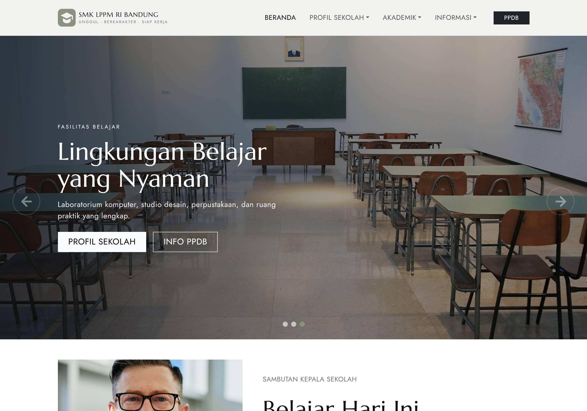

<p align="center">
  
</p>

<h1 align="center">SMK LPPM RI BANDUNG</h1>

<p align="center"><em>Unggul · Berkarakter · Siap Kerja</em></p>

<p align="center">
  Website profil sekolah yang menyajikan informasi akademik, kompetensi keahlian,
  kegiatan siswa, berita, dan kontak dalam satu situs yang cepat, responsif, dan bisa
  diakses tanpa koneksi internet.
</p>

<p align="center">
  
  
  
  
</p>

---

## Tentang Website

SMK LPPM RI Bandung adalah sekolah menengah kejuruan di Kota Bandung dengan empat
kompetensi keahlian: Teknik Komputer & Jaringan, Rekayasa Perangkat Lunak, Desain
Komunikasi Visual, serta Akuntansi & Keuangan Lembaga.

Website ini menjadi wajah digital sekolah. Semua informasi yang biasanya ditanyakan
calon siswa, orang tua, dan masyarakat dikumpulkan dalam satu tempat: profil sekolah,
jurusan, ekstrakurikuler, dokumentasi kegiatan, berita, sampai cara menghubungi sekolah.

Website dibangun sebagai **Single Page Application (SPA)**. Perpindahan halaman terjadi
tanpa memuat ulang browser, sehingga terasa cepat dan mulus. Seluruh aset desain,
gambar, dan font disimpan di dalam proyek, jadi tampilan tetap utuh walaupun perangkat
sedang offline.

### Untuk siapa website ini

- **Calon siswa dan orang tua** — mengenal sekolah, melihat jurusan, dan membaca
  informasi penerimaan siswa baru.
- **Siswa dan alumni** — mengikuti berita, agenda, dan dokumentasi kegiatan sekolah.
- **Guru dan staf** — menjadi rujukan informasi resmi sekolah.
- **Masyarakat dan mitra industri** — mengetahui profil sekolah dan cara menghubungi.

### Tujuan

1. Menyediakan pusat informasi sekolah yang lengkap dan mudah diakses.
2. Mendukung promosi penerimaan peserta didik baru (PPDB).
3. Mendokumentasikan kegiatan, fasilitas, dan prestasi siswa.
4. Mempermudah komunikasi antara sekolah dan masyarakat.

---

## Sorotan

- **11 tampilan** — 8 halaman utama, 3 halaman detail berita, dan halaman 404.
- **Empat kompetensi keahlian** dengan tab interaktif yang bisa dibagikan lewat URL.
- **Pencarian berita** dan **pagination** pada berita maupun galeri.
- **Filter kategori** untuk ekstrakurikuler dan galeri.
- **Galeri foto** dengan pratinjau modal, 12 foto per halaman (4 kolom × 3 baris di desktop).
- **Form kontak** dengan validasi langsung di browser.
- **Peta lokasi** dengan tampilan cadangan saat offline.
- **Seluruh aset lokal** — tanpa CDN, tanpa Google Fonts.
- **Ramah aksesibilitas** — navigasi keyboard, skip link, dan dukungan `prefers-reduced-motion`.

---

## Halaman

### Beranda
Halaman pertama yang menyambut pengunjung: slider sorotan sekolah, sambutan kepala
sekolah, statistik sekolah dengan animasi angka, ringkasan empat jurusan, cuplikan
ekstrakurikuler, berita terbaru, galeri kegiatan, dan daftar mitra industri.

### Profil Sekolah
Mengenalkan sekolah secara menyeluruh: sambutan kepala sekolah, sejarah dan keunggulan,
visi & misi, struktur organisasi, tabel data profil, serta fasilitas. Setiap bagian
punya tautan langsung, misalnya `/profil#visi-misi`, sehingga bisa dibagikan ke orang lain.

### Kompetensi Keahlian
Empat jurusan disajikan dalam tab: TKJ, RPL, DKV, dan AKL. Setiap tab memuat deskripsi,
gambaran karier, dan fasilitas pendukung. Tab aktif tersimpan di alamat halaman, jadi
`/jurusan#rpl` langsung membuka jurusan RPL.

### Ekstrakurikuler
Daftar kegiatan di luar jam pelajaran dengan penyaringan kategori: kepemimpinan,
olahraga, akademik, sosial, dan seni. Setiap kartu memuat pembina dan jadwal latihan.

### Galeri
Dokumentasi kegiatan belajar, fasilitas, dan prestasi. Foto dapat disaring berdasarkan
kategori, ditampilkan 12 per halaman, dan diperbesar lewat modal tanpa meninggalkan
halaman.

### Berita & Pengumuman
Daftar berita tersusun ke bawah dengan gambar di sisi kiri. Di sisi kanan terdapat
panel **Agenda Terdekat** dan **Pengumuman Singkat** yang tetap terlihat saat halaman
digulir. Pengunjung bisa mencari berita berdasarkan judul, kategori, tanggal, atau
ringkasan. Daftar berita dibagi 3 per halaman.

### Detail Berita
Tiga artikel lengkap: pembukaan PPDB, prestasi siswa di lomba web design nasional, dan
kunjungan industri. Setiap artikel dilengkapi poin-poin penting dan tautan kembali ke
daftar berita.

### Kontak
Informasi alamat, telepon, WhatsApp, email, dan jam layanan. Tersedia form pesan dengan
validasi, peta lokasi Google Maps, serta panel alamat sebagai pengganti peta ketika
perangkat offline.

### Halaman 404
Tampil ketika alamat yang dibuka tidak tersedia, misalnya `/berita/judul-yang-salah`,
dengan tautan kembali ke beranda.

---

## Teknologi

| Bagian | Teknologi | Peran |
| --- | --- | --- |
| Antarmuka | React 19 | Membangun halaman dari komponen yang dapat dipakai ulang |
| Build tool | Vite 8 | Server pengembangan cepat dan proses build produksi |
| Routing | React Router 7 | Navigasi antar halaman tanpa memuat ulang browser |
| CSS framework | Bootstrap 5.3.3 | Grid, komponen, dan utilitas tampilan |
| Slider | Swiper 11 | Slider hero di beranda |
| Animasi | AOS 2.3.4 | Animasi muncul saat halaman digulir |
| Bahasa | JavaScript / JSX | Logika aplikasi dan penulisan komponen |

Desain dasar memakai template **Kaira** yang sudah disesuaikan agar seluruh tampilan,
warna, dan tipografi tetap konsisten. Penyesuaian khusus proyek dikumpulkan di
`public/css/school.css`.

---

## Menjalankan Website

Prasyarat: **Node.js 18+** dan npm.

```bash
npm install     # pasang dependensi (sekali saja)
npm run dev     # jalankan server pengembangan, biasanya di http://localhost:5173
npm run build   # buat versi produksi ke folder dist/
npm run preview # coba hasil build, biasanya di http://localhost:4173
```

> Di Windows PowerShell, jika `npm` terblokir Execution Policy, gunakan `npm.cmd`,
> misalnya `npm.cmd run dev`.

Versi produksi ada di folder `dist/` dan siap diunggah ke layanan hosting statis.

---

## Struktur Proyek

```
Tugas_sekolah-react/
├─ index.html                # kerangka HTML dan urutan stylesheet
├─ vite.config.js
├─ package.json
├─ public/
│  ├─ css/                   # bootstrap, fonts, vendor, swiper, style.css, school.css
│  ├─ fonts/                 # font lokal (Jost & Marcellus)
│  └─ images/                # seluruh gambar website
└─ src/
   ├─ main.jsx               # titik masuk React
   ├─ App.jsx                # daftar rute dan inisialisasi animasi
   ├─ components/
   │  ├─ common/             # komponen UI yang dipakai berulang
   │  ├─ home/               # bagian-bagian khusus beranda
   │  └─ layout/             # navbar, footer, kerangka halaman
   ├─ data/                  # seluruh konten website
   ├─ hooks/                 # logika kecil yang dipakai ulang
   └─ pages/                 # satu file untuk setiap halaman
```

---

## Pengelolaan Konten

Seluruh teks, gambar, dan daftar isi website berada di folder `src/data/`, terpisah dari
kode tampilan. Halaman hanya membaca data tersebut lalu menampilkannya. Dengan cara ini,
isi website bisa diperbarui tanpa menyentuh struktur komponen.

| File | Isi |
| --- | --- |
| `site.js` | Identitas sekolah, alamat, telepon, WhatsApp, email, jam layanan, media sosial |
| `navigation.js` | Menu utama, submenu, tombol PPDB, tautan footer |
| `home.js` | Konten beranda: slider, sambutan, statistik, program, mitra |
| `profil.js` | Sambutan kepala sekolah, sejarah, visi-misi, struktur, tabel data, fasilitas |
| `jurusan.js` | Empat kompetensi keahlian beserta deskripsi dan fasilitas |
| `ekstrakurikuler.js` | Daftar ekstrakurikuler dan kategori filter |
| `galeri.js` | Koleksi foto, kategori, dan pengaturan pagination |
| `berita.js` | Artikel, pengumuman, agenda, dan pengaturan pagination berita |
| `kontak.js` | Informasi kontak, konfigurasi form, teks cadangan peta |
| `notFound.js` | Konten halaman 404 |

Karena konten dan tampilan dipisahkan, perubahan seperti memperbarui agenda sekolah atau
menambah artikel baru cukup dilakukan di satu tempat dan langsung tampil di seluruh
halaman terkait.

---

## Desain dan Pengalaman Pengguna

**Karakter visual.** Palet warna netral dengan aksen zaitun dan hitam, mengikuti template
Kaira. Judul memakai font Marcellus, sedangkan teks isi memakai Jost. Kombinasi ini
memberi kesan tenang, rapi, dan tetap formal sebagai situs sekolah.

**Layout.** Halaman disusun dengan grid 12 kolom Bootstrap. Di layar besar konten tampil
lebar dan seimbang; di tablet kolom menyesuaikan; di ponsel hampir semua bagian menjadi
satu kolom agar mudah dibaca.

**Interaksi.** Navigasi memakai menu desktop dan offcanvas di ponsel. Slider beranda
berjalan otomatis dan bisa digeser. Filter, pencarian, tab, modal galeri, dan pagination
bekerja tanpa memuat ulang halaman.

**Animasi.** Elemen muncul dengan efek lembut saat masuk area tampilan. Pengguna yang
mengaktifkan pengurangan gerak di sistem operasinya akan mendapat tampilan tanpa animasi.

**Aksesibilitas.** Tersedia tautan lewati ke konten utama, label pada tombol ikon,
atribut `aria` pada komponen interaktif, indikator fokus, dan struktur judul yang runtut.

---

## Aset dan Mode Offline

- Seluruh CSS, font, dan gambar disimpan di `public/` dan dimuat dengan path absolut
  (`/images/...`, `/css/...`).
- Tidak ada CDN, Google Fonts, atau aset pihak ketiga yang dimuat saat halaman dibuka.
- Peta memakai iframe Google Maps sehingga memerlukan internet. Bila perangkat offline,
  halaman kontak otomatis menampilkan panel alamat beserta tautan peta.
- Tautan WhatsApp, Instagram, YouTube, dan Google Maps tetap mengarah ke situs eksternal
  dan dibuka di tab baru.

---

## Catatan

- **Form kontak bersifat demonstrasi.** Pesan tidak dikirim ke server; form yang valid
  hanya menampilkan pesan sukses lalu dikosongkan kembali.
- **Hosting SPA.** Karena memakai `BrowserRouter`, server hosting perlu diarahkan kembali
  ke `index.html` agar halaman seperti `/profil` atau `/berita/ppdb` tidak menghasilkan 404
  saat dimuat ulang langsung.
- **Data contoh.** Nama sekolah, alamat, kontak, dan sebagian data identitas merupakan
  contoh yang bisa diganti kapan saja melalui folder `src/data/`.

---

## Kredit

- Template desain: **Kaira**
- React, Vite, React Router — lisensi MIT
- Bootstrap — lisensi MIT
- Swiper — lisensi MIT
- AOS (Animate On Scroll) — lisensi MIT
- Font Jost dan Marcellus — SIL Open Font License

---

<p align="center"><sub>Dibuat untuk keperluan pembelajaran dan uji sertifikasi.</sub></p>
